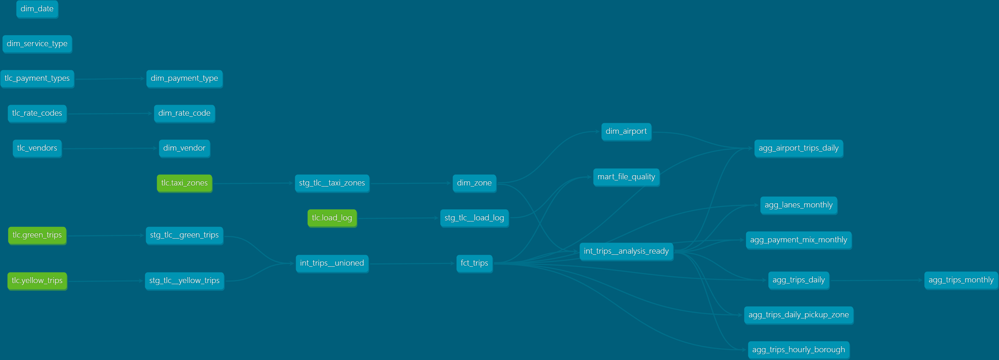

# dbt-postgres-warehouse-demo

A data warehouse on PostgreSQL built with dbt, on real public data: NYC Taxi & Limousine
Commission (TLC) yellow and green taxi trip records. A small Python ingestion system loads the
monthly files into PostgreSQL incrementally; dbt models them into a star schema with tests.

**Status: work in progress.** Ingestion, 22 dbt models with tests, and CI exist. Publishing the
dbt docs site is set up but not live yet. Progress is tracked in the epic issue and on the
[Portfolio build-out](https://github.com/users/gkhnelbstn/projects/6) board.



## What is in the repo

```
src/tlc_ingest/   ingestion CLI (download, load log, COPY into partitioned raw tables)
tests/            unit tests and end-to-end tests against PostgreSQL with a fake CDN
dbt/              dbt project: sources, staging, intermediate, marts, seeds
compose.yaml      PostgreSQL 17 with a healthcheck, tuned for bulk loads
.github/          CI: lint, tests, ingest a real sample, dbt build twice, dbt docs site
docs/             lineage graph image
```

### Data

[TLC trip record data](https://www.nyc.gov/site/tlc/about/tlc-trip-record-data.page): one
Parquet file per service and month, published monthly with about a two-month delay, no login.
The zone lookup CSV (265 zones) comes from the same site. TLC notes that the trip data is
submitted by technology providers and that it makes no representations as to its accuracy.
No data files are stored in this repo.

### Ingestion (`tlc-ingest`)

```
TLC CDN --HEAD (ETag)--> skip if already loaded
        --GET (resumable)--> local cache --pyarrow batches--> COPY --> raw.<dataset>_<yyyy_mm>
                                                                  \--> raw.load_log
```

- **Incremental and idempotent.** Before each file it compares the published ETag with the last
  successful load in `raw.load_log`. The same command run twice loads nothing the second time; a
  month TLC republishes is reloaded.
- **Atomic per file.** Each file replaces its own partition (`create partition if missing`,
  `truncate`, `COPY`, update the log) in one transaction. With `wal_level=minimal` the `COPY`
  into a partition truncated in the same transaction skips WAL.
- **Resumable.** Downloads go to a `.part` file tagged with the ETag and resume with a `Range`
  request; a failed load rolls back and is recorded as `failed` with the error.
- **Checked.** Rows written by `COPY` must equal the row count in the Parquet footer, or the
  load fails. Casts are overflow-safe.
- **Schema drift.** Columns are matched case-insensitively (`Airport_fee`/`airport_fee`).
  Columns older files lack (`cbd_congestion_fee`, `request_source`) become nulls; columns the
  raw table does not know are logged and skipped.
- **Guarded.** A month missing inside the range, or a range with no published month at all, is
  an error, so a blocked or wrong URL cannot pass as "nothing new".
- `raw.yellow_trips` and `raw.green_trips` are list-partitioned by `source_month` (the month of
  the file). Each row keeps `_source_file`, `_source_row` and `_loaded_at`.

### dbt

| Layer | Models |
|---|---|
| sources | `raw.yellow_trips`, `raw.green_trips`, `raw.taxi_zones`, `raw.load_log` (freshness on `load_log`) |
| staging (views) | `stg_tlc__yellow_trips`, `stg_tlc__green_trips`, `stg_tlc__taxi_zones`, `stg_tlc__load_log` |
| intermediate (views) | `int_trips__unioned`: both services in one shape, stable `trip_id`, `is_valid` flag; `int_trips__analysis_ready`: valid trips with pickup in their file month, with boroughs |
| facts and dimensions | `fct_trips` (incremental), `dim_zone`, `dim_date`, `dim_vendor`, `dim_payment_type`, `dim_rate_code`, `dim_service_type`, `dim_airport` |
| aggregates (incremental) | `agg_trips_daily`, `agg_trips_daily_pickup_zone`, `agg_trips_hourly_borough`, `agg_lanes_monthly` (origin-destination lanes), `agg_airport_trips_daily`, `agg_payment_mix_monthly`; `agg_trips_monthly` (table, from the daily aggregate) |
| data quality | `mart_file_quality`: per file, rows in the file, in raw and in `fct_trips`, and rows breaking each validity rule |
| seeds | vendor, payment type and rate code lookups from the TLC data dictionaries |

**Incremental by file month, end to end.** `fct_trips` reads from `raw.load_log` which
(service, month) files were loaded since its last build, inlines that list as constants so
PostgreSQL prunes the raw partitions, and replaces those months (`delete+insert`). The
aggregates and `mart_file_quality` do the same one level up: the `new_file_months` macro finds
the months whose `fct_trips` rows are newer than the aggregate's own `loaded_at` and replaces
only those. A run with nothing new inserts 0 rows everywhere.

Aggregates count only `int_trips__analysis_ready` trips: valid, and picked up in the month of
the file they came from. That excludes 666 of 92.3 million valid trips in the 24-month load and
makes every pickup date belong to exactly one file, so a month can be replaced on its own.

**Tests.** Every primary key (single-column or composite, the latter with
`dbt_utils.unique_combination_of_columns`) and every foreign key has a test.
`mart_file_quality.is_reconciled` must be true for every file: each row the loader put into raw
reached `fct_trips`.

## Run it

Requirements: Docker, [uv](https://docs.astral.sh/uv/).

```bash
cp .env.example .env        # then set PGPASSWORD
docker compose up -d --wait
uv sync
```

Load the environment variables from `.env` into your shell (for example
`set -a; source .env; set +a` in bash), then:

```bash
# small sample: two months, first 50k rows of each file (what CI runs)
uv run tlc-ingest --dataset yellow --dataset green --from 2026-08 --to 2026-09 --max-rows 50000
uv run dbt deps
uv run dbt build
```

Full data, 24 months:

```bash
uv run tlc-ingest --dataset yellow --dataset green --from 2024-10 --to 2026-09
uv run dbt build
uv run dbt source freshness
```

Re-run the same `tlc-ingest` command any time; it only loads what is new or changed.
Inspect loads with `select * from raw.load_log order by load_id desc;`.

Docs: `uv run dbt docs generate && uv run dbt docs serve`. CI also builds a static docs site
from the sample run on every push; deploying it to GitHub Pages from `main` is wired up in
`.github/workflows/ci.yml` and switched on by the repository variable `DEPLOY_DOCS=true`.
That site describes the sample data (50,000 rows per yellow file), not the 24-month load.

Tests: `uv run pytest` (the database tests use a throwaway `tlc_ingest_test` database and are
skipped when `PGHOST` is not set). Lint: `uv run ruff check && uv run ruff format --check`.

## Measured full load

One run on a Windows 11 laptop (16 logical cores, 32 GB RAM, Docker Desktop, PostgreSQL 17 in
the container from `compose.yaml`), over a home internet connection, on 2026-11-14:

| | |
|---|---|
| Range | 2024-10 to 2026-09, yellow and green (48 trip files plus the zone lookup) |
| Rows loaded | 94,588,040 trips (yellow 93,450,512; green 1,137,528), equal to the Parquet row counts |
| Downloaded Parquet | 1.63 GB |
| `raw` tables in PostgreSQL | 20 GB |
| `tlc-ingest` wall time | 35.0 minutes for 47 files (download and load; one green month was already loaded) |
| `dbt build` over all of it | 19.7 minutes, 47 of 47 nodes passed; building `fct_trips` took 13.1 of those minutes |
| `fct_trips` | 94,588,040 rows, 22 GB with indexes; 2,319,504 rows (2.5%) flagged `is_valid = false` |
| Database total | 42 GB |
| Incremental `fct_trips` run with nothing new | 0.8 seconds, 0 rows inserted |

Times include downloads, so they depend on the connection as well as the machine.

**Memory.** The container is capped at 4 GB (`PG_MEM_LIMIT` in `.env`). Without a cap, the Linux
page cache from these loads is charged to the container and kept: after the run above, Docker
Desktop showed the container at 19.95 GiB while PostgreSQL itself used about 1 GB. Under the
4 GB cap, a full rebuild of `fct_trips` took 13.3 minutes (796 s, against 786 s uncapped) and
its tests passed, with memory peaking at the cap and no out-of-memory kill.

## License

Code: MIT (see `LICENSE`). Data: NYC TLC trip records, published by the City of New York.
